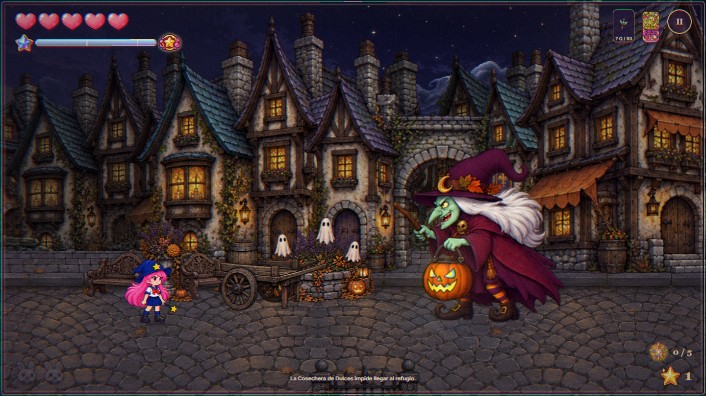

# Revisión 11 · Magia iluminada y la Cosechera de Dulces

15 de octubre de 2026. Antes de estos cambios se guardó y subió a `origin/paralax` el estado completo anterior: `4de58a3727fe55f610ecc768e3d8c22573d298f5`. Esta revisión posterior queda en el árbol de trabajo local.

## Ataques de Hexy

- Resplandor local en los disparos normales y fuertes, sus impactos, la punta de la varita, campos persistentes, satélites, recorrido de Aqua y ramas de Volt. El suelo recibe una luz difusa según su distancia al efecto. Se respeta la oclusión de los elementos del primer plano.
- Sonidos diferenciados de fuego, búmeran, hojas, burbujas, estrellas, agua, gelatina, cristal, eco, electricidad, miel, órbitas y cinta. Popcorn conserva su síntesis de explosiones. Volt añade chasquidos y una voz continua modulada mientras se mantiene el rayo. Todo usa el bus existente de efectos, volumen y silencio; las voces se detienen al soltar el ataque, pausar o salir.
- Volt III aumenta el alcance normal de 315 a 650 y el cargado de 850 a 1150 unidades. Las ramas recorren todos los enemigos conectados del grupo cercano, sin el límite anterior de tres/cinco objetivos. No repiten daño, respetan paredes y paraguas, y conservan al menos el 65 % del daño al propagarse. Cada salto alcanza 200/340 unidades y el grupo se limita a un radio de 500/850 alrededor del impacto inicial: no encadena enemigos remotos del nivel completo. Los niveles I y II mantienen su comportamiento anterior.
- Las tropas compatibles conservan su identidad al electrocutarse: reacción, temblor, arcos y una breve reducción de movimiento. La derrota eléctrica deja el cuerpo ennegrecido con humo durante 1,9 segundos. No se aplica ese tratamiento a maquinaria ni jefes.
- Ocho dibujos nuevos para el retroceso de Popcorn fuerte de pie, apuntando horizontalmente: el cabello se desplaza hacia atrás y se asienta. La estrella de cada celda está registrada para calcular el punto real de salida. El resto de direcciones conserva sus poses registradas.

## Minijefe del refugio

**La Cosechera de Dulces**, tipo 28, aparece al final de Villa Lumbre. Tiene 185 puntos internos de resistencia y ninguna barra de vida. El encuentro comienza a 680 unidades de su posición; la cámara se abre suavemente para mantenerla junto a Hexy.

El farol de calabaza acompaña 32 poses de reposo, preparación, lanzamiento, daño, absorción, agrietamiento y derrota. Lanza abanicos de magia transformadora y, cada tercer ataque, gotas que dejan maldiciones en el suelo. Alterna blancos entre Hexy y los vecinos usando las reglas del pueblo. Puede absorber dulces reales y convertir a sus víctimas en calabazas rescatables, con un máximo de tres simultáneas por bruja. Hexy convertida en dulce también puede ser absorbida e interrumpir esa captura mediante las reglas existentes.

Al llegar al 50 % de resistencia se agrieta el farol: la preparación baja de 1,05 a 0,75 segundos, el abanico pasa de dos a tres rayos y la lluvia de tres a cinco gotas. Quedan pausas de recuperación entre ataques. Al derrotarla rompe el farol, libera las víctimas que aún contiene y espera su animación de 2,6 segundos antes de permitir completar la plaza. Reiniciar reconstruye el encuentro con su resistencia completa.



## Arte y registro

Modo: **herramienta integrada ImageGen**, con transparencia real y referencias de los personajes existentes. [Prompts completos](prompts.json). Fuentes originales en [sources](sources/); mediciones del empaquetado en [registration.json](registration.json).

Archivos consumidos por el juego:

- `public/arcade/sprites/bosses/harvester-combat.webp`
- `public/arcade/sprites/bosses/harvester-ritual.webp`
- `public/arcade/sprites/hexy/popcorn-recoil.webp`
- `src/components/arcade/adventure/actors/hexy/hexyPopcornAtlas.js`

`node scripts/arcade/pack-village-v11.mjs` reproduce el empaquetado. Los canales transparentes, las separaciones reales entre filas y la selección del personaje conectado evitan restos de varitas o botas de las celdas vecinas. Sharp se usa para extracción y registro técnico; las ilustraciones son las generadas con ImageGen.

## Verificación

40 pruebas aprobadas: 39 de lógica/regresión y una en Chrome entrando desde el menú, eligiendo el capítulo y disparando con el teclado. Se verifican ramas, paredes, reacciones, derrotas, sincronización de Popcorn, absorción, interrupción, rescate, final y reinicio del minijefe; también las reglas anteriores de obstáculos, civiles y liberación a los 30 segundos.

```powershell
npx playwright test tests/hexy-combat-revision-11.spec.js tests/hexy-combat-revision-11-browser.spec.js tests/hexy-extra-drinks.spec.js tests/hexy-drink-revision.spec.js tests/hexy-village-revision-10.spec.js --reporter=line
node scripts/arcade/review-combat-v11.mjs
npm run build
```

La primera prueba de navegador agotó la espera de 30 segundos cargando los recursos. Con la misma espera inicial de 90 segundos usada por la revisión anterior, pasó en 20,6 segundos. `npm run build`: cero errores, cero advertencias de Astro Check, 29 sugerencias existentes y `[build] Complete!`.

Revisión visual realizada sobre capturas del capítulo real y fotogramas decodificados del vídeo de 14,9 segundos: introducción, preparación, disparo, grietas, absorción y derrota. La grabación usa una escena controlada y cambios de resistencia para recorrer ambas fases; la prueba de navegador valida además daño real mediante teclado. [Fotogramas finales](harvester-motion.png).

Artefactos reproducibles en `tests/artifacts/arcade/combat-v11/`: capturas de Volt, tropas ennegrecidas, Popcorn, galería de ataques, vídeo `harvester.webm`, señal de audio `attacks.wav` y `review.json`. El audio de 37 eventos se renderizó con el bus real: pico 0,652, cero muestras saturadas y cola final silenciosa. Esta medición verifica la señal; no sustituye la valoración de mezcla al jugar con música.
