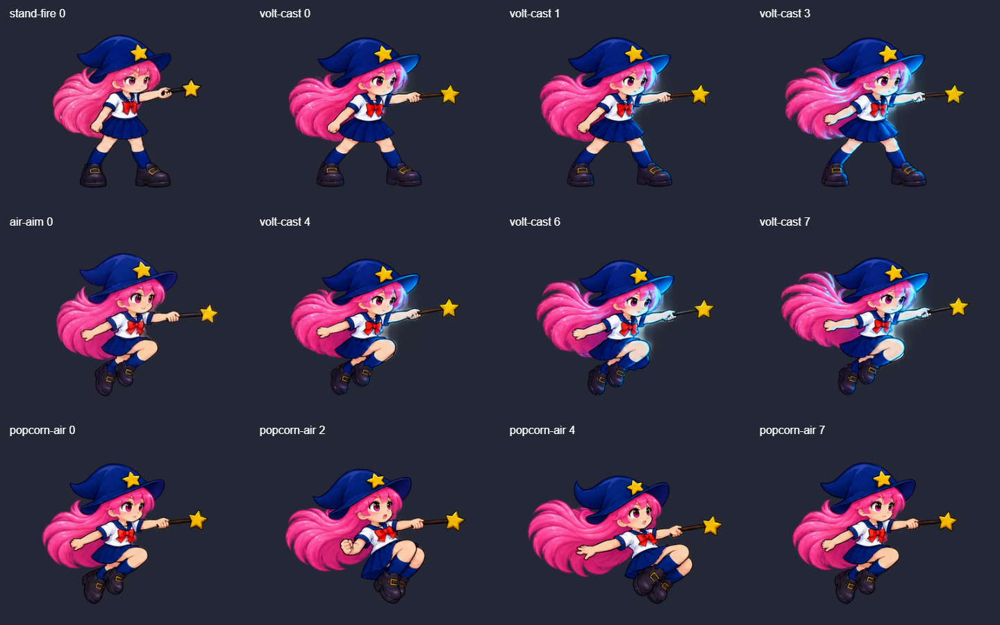
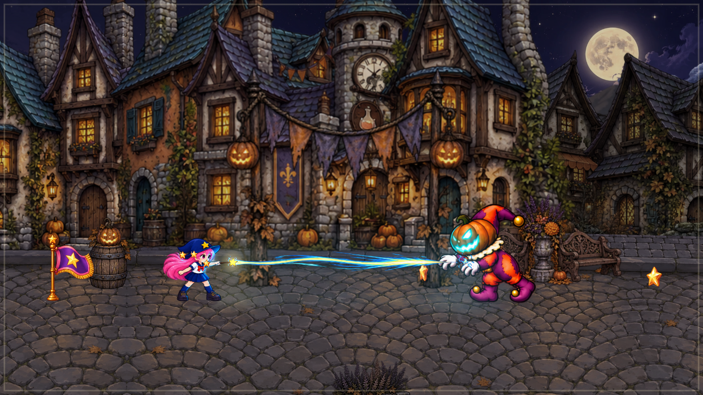

# Revisión 12 · Sprites de ataque y FX del pueblo

16 de octubre de 2026. Continúa la revisión 11. Cambios locales; no se hizo otro commit ni push.

## Sprites dibujados

- [volt-cast.webp](../../../../public/arcade/sprites/hexy/volt-cast.webp): 16 cuadros con iluminación azul pintada en cara, brazo, sombrero y ropa, y movimiento del cabello. Cuatro poses de pie horizontales, cuatro aéreas horizontales, cuatro diagonales hacia arriba de pie y cuatro agachadas. Los demás ángulos y la carrera conservan sus animaciones existentes.
- [popcorn-air.webp](../../../../public/arcade/sprites/hexy/popcorn-air.webp): ocho cuadros de reacción al disparo fuerte en el aire: compresión, inclinación del torso, cabello arrastrado y recuperación.
- Se conserva la animación de Popcorn de pie de la revisión 11. Las puntas de las varitas se midieron en cada celda nueva y usan la misma transformación que el dibujo y los proyectiles.
- No se añadió un filtro de luminosidad sobre Hexy. Los reflejos azules pertenecen al arte nuevo. Los rayos y proyectiles siguen siendo elementos independientes del personaje.

Generación con **ImageGen integrado**, modo edición con referencias de identidad. [Prompts completos](prompts.json), originales en [sources](sources), [registro de celdas y puntas](registration.json). Empaquetado reproducible mediante `node scripts/arcade/pack-combat-v12.mjs`; Sharp sólo recorta, registra, escala y comprime.

## Reacción física

Popcorn fuerte añade un retroceso horizontal de 15 unidades durante 0,2 segundos, opuesto al disparo. Se resuelve con las mismas paredes y límites que el desplazamiento normal. Si Hexy cae, frena la caída y recibe un impulso vertical pequeño; no recupera un salto y sólo se permite una elevación por tramo aéreo. El disparo normal no añade retroceso. Se conservan los siete proyectiles, daño, alcance y costes anteriores.

## Sonido

El disparo básico y su versión fuerte conservan exactamente la síntesis de la revisión 11, por petición expresa del usuario.

Las demás familias usan capas de aire, presión, crujidos y resonancias breves, con variaciones pequeñas y reflexiones cortas. Volt mantiene una textura eléctrica continua que termina al soltar, pausar o perder el control del ataque. Aqua usa flujo de agua.

Brujas y calabazas tienen lanzamientos e impactos específicos. Las conversiones, liberaciones, absorción, nacimiento/rotura de calabazas, escombros, madera, carretas, derrumbes, piedras y caídas tienen eventos propios. La absorción mantiene un sonido mientras la acción está activa. Los efectos del mundo se sitúan en estéreo y atenúan por distancia; un abanico de tres proyectiles produce un solo lanzamiento. Mute y volumen siguen pasando por el bus común.

Son efectos procedurales originales de Web Audio, no grabaciones externas. Se verificó la señal renderizada y su integración; no se realizó una escucha subjetiva desde estas herramientas.

## Verificación

- **49 pruebas distintas aprobadas**: 47 de comportamiento/regresión y dos del navegador con controles reales. Se repitieron 24 pruebas afectadas después de los últimos ajustes de escala y cajas.
- `npm run build`: **0 errores**, termina en `[build] Complete!`.
- Comparación visual de sprites originales/nuevos, captura del escenario y vídeo de seis segundos decodificado: Volt en ambos sentidos y retroceso aéreo de Popcorn.
- 56 eventos de audio renderizados en estéreo: todos tienen señal finita, pico máximo 0,616 y cero muestras saturadas. Los canales de Volt/absorción quedan en silencio después de detenerlos. Diferencia máxima del básico frente a la síntesis anterior: 1,87e-9 (redondeo numérico).
- `git diff --check` limpio.

Reproducir: `node scripts/arcade/review-combat-v12.mjs`. Capturas, vídeo, `fx-preview.wav`, `channels-release.wav` y `review.json` en `tests/artifacts/arcade/combat-v12/`; logs `tests/artifacts/arcade/revision12-*.log`.

